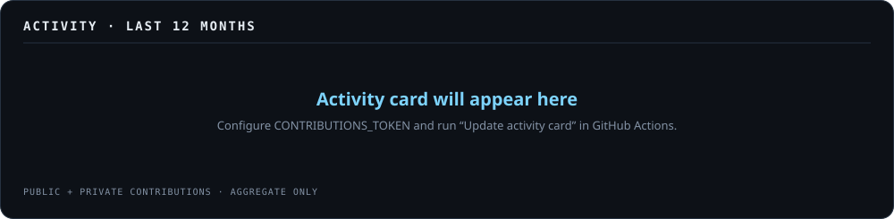

  

  
  

## About

I build software across native applications, game-related systems and the web. I enjoy understanding how things work under the hood and turning that knowledge into working software.

## Toolbox

**Languages**

  

**Frameworks & runtime**

  

**Database**

  

## Activity

  

